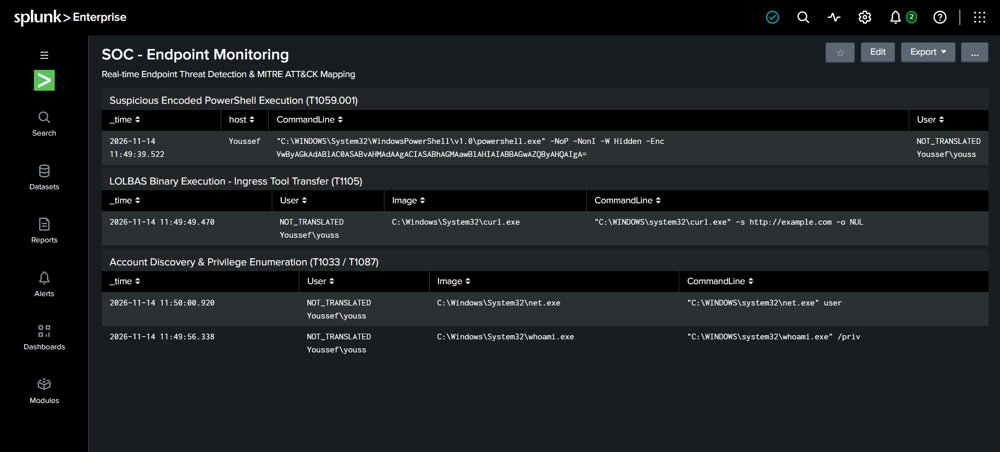

# SOC Tier 1 Home Lab - Endpoint Threat Monitoring

## Overview
This repository documents a complete SOC Tier 1 monitoring and endpoint threat-hunting home lab. The environment ingests live Windows Security event logs and Sysmon telemetry into Splunk Enterprise hosted on an Ubuntu Server VM, enabling behavioral threat detection mapped to the MITRE ATT&CK framework.

## Lab Architecture
| Component | Details |
| :--- | :--- |
| **SIEM Platform** | Splunk Enterprise 10.6.1 on Ubuntu Server VM (192.168.1.20) |
| **Monitored Endpoint** | Windows Host (`Youssef`) |
| **Log Collection** | Splunk Universal Forwarder (Port 9997) |
| **Telemetry Sources** | Windows Security Logs & Sysmon (SwiftOnSecurity Configuration) |

## SOC Monitoring Dashboard
The dashboard consolidates critical endpoint telemetry, suspicious LOLBAS executions, and obfuscated scripting into a unified view:



## Detection Scenarios & MITRE ATT&CK Mapping
| Threat Scenario | Event Source | Event ID | MITRE ATT&CK | Description |
| :--- | :--- | :--- | :--- | :--- |
| **Encoded PowerShell** | Sysmon / Security | 1 / 4688 | T1059.001 | Detects Base64 obfuscated PowerShell execution |
| **LOLBAS Execution** | Sysmon | 1, 3 | T1105 | Captures native tool misuse (`curl.exe`) for ingress transfer |
| **Discovery / Privileges** | Sysmon | 1 | T1033, T1087 | Tracks enumeration tools (`whoami.exe`, `net.exe`) |

## Incident Investigation Reports
- [IR-2026-002: Encoded PowerShell & LOLBAS Execution](reports/IR-2026-002-endpoint-investigation.md)

## Repository Structure
```text
├── configs/
│   └── inputs.conf                           # Splunk Universal Forwarder configuration
├── queries/
│   └── detection_queries.spl                 # Detection and hunting SPL rules
├── reports/
│   └── IR-2026-002-endpoint-investigation.md # SOC Tier 1 Incident Investigation Report
├── Screenshots/
│   └── dashboard.png                         # Live Splunk SOC dashboard capture
└── README.md
